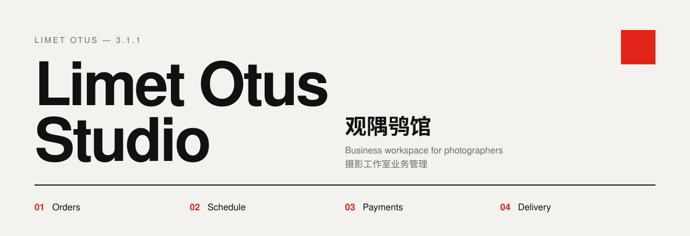
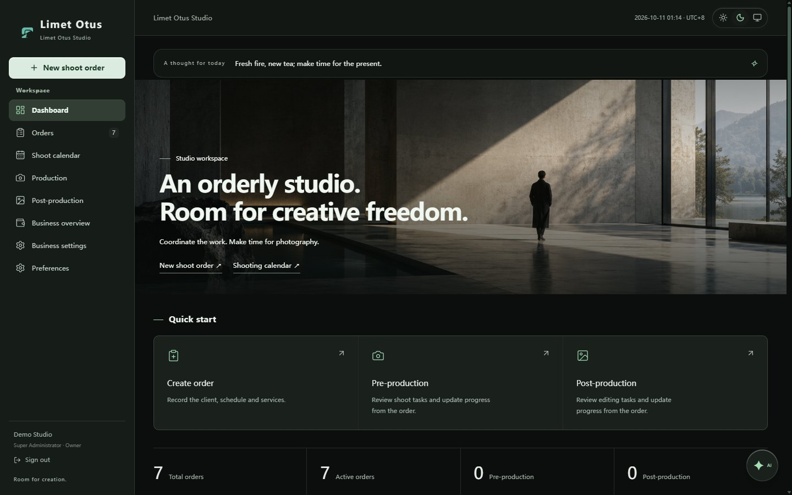
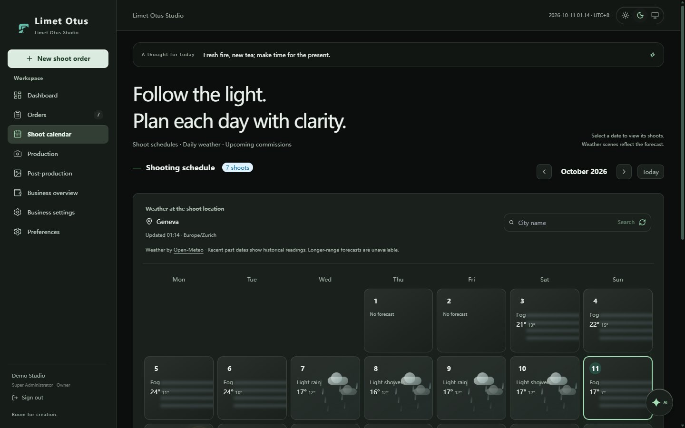
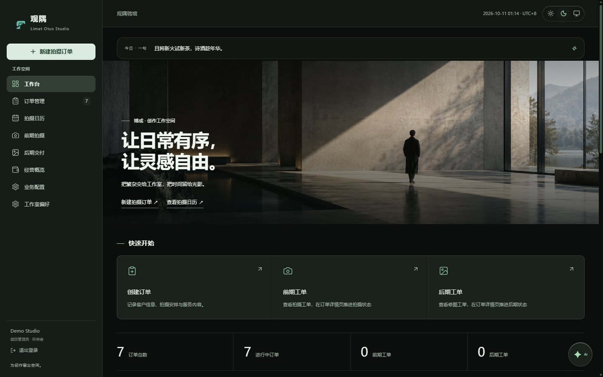
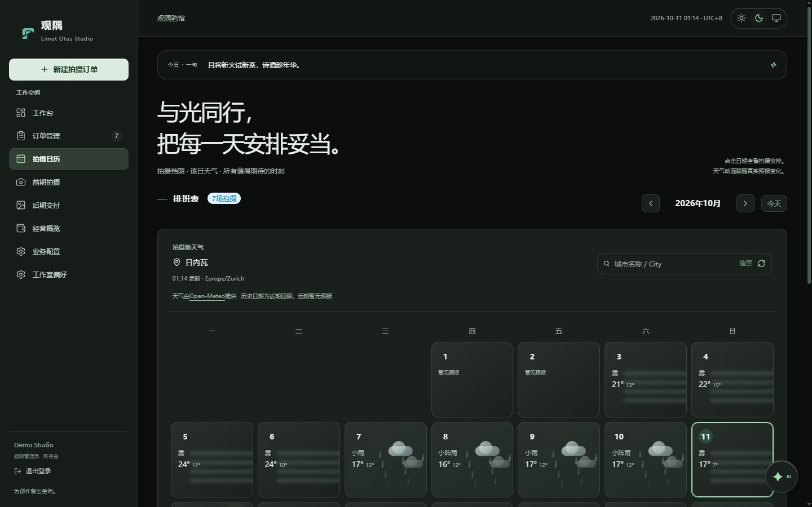

<picture>
  <source media="(prefers-color-scheme: dark)" srcset="docs/images/banner-dark.svg">
  
</picture>

[](docs/English/Changelog.md)
[](LICENSE)
[](docs/English/Deployment-manual.md)
[](docs/English/README.md)

**[English](#english)** · **[中文](#中文)**

---

## English

### 01 — Overview

Limet Otus Studio is a business workspace designed for individual photographers and very small studios, particularly in ACGN (anime, comics and games) photography. Other small studios and independent photographers can use it just as well.

Bookings, orders, shoot schedules, production and editing tasks, equipment, payments, team shares and delivery, in one place: on the Windows desktop, or on your own server.

AI assistance was used in the development of this software.

### 02 — Features

| | |
| --- | --- |
| **Orders** | Bookings, packages and extras, automatic order numbers, production and editing tasks, delivery confirmation |
| **Calendar** | Daily shoots with forecasts and location advice |
| **Payments** | Configurable instalments and refund tiers, expenses, member shares with fixed, percentage or mixed plans. Amounts are internal estimates, not accounting records |
| **Printing** | Booking forms, confirmations and payment summaries with editable terms and templates |
| **Team** | Invitation-only registration, five roles, fifteen scopes, API keys, audit log |
| **Assistant** | OpenAI-compatible or Anthropic models; every change needs your confirmation. Two personas, Limenotus and Limenotessa, with optional in-app speech recognition and synthesis |
| **Command panel** | Fixed-grammar CLI for the super administrator, with preview and confirmation |
| **Retention** | Retention from delivery, reminders, extension approvals, cleanup of client details |
| **Interface** | Chinese and English, dark and light themes, studio time zone, common ledger currencies |

### 03 — Screens

<table>
  <tr>
    <td width="50%"></td>
    <td width="50%"></td>
  </tr>
  <tr>
    <td><sub>Workspace</sub></td>
    <td><sub>Shoot calendar and weather</sub></td>
  </tr>
</table>

<sub>Fictional demo data. Weather for Geneva from Open-Meteo.</sub>

### 04 — Download

Windows installer and portable builds are published on the **Releases** page with SHA-256 checksums. Speech models are downloaded from within the app.

### 05 — Start here

| I want to | Read |
| --- | --- |
| Use the desktop app | [User manual](docs/English/User-manual.md) |
| Deploy for my team | [Deployment manual](docs/English/Deployment-manual.md) |
| Build or modify the code | [Developer manual](docs/English/Developer-manual.md) |
| Integrate over HTTP | [API reference](docs/English/API-reference.md) |
| Look up an error or message | [Error and message reference](docs/English/Error-reference.md) |
| See all documentation | [Documentation index](docs/English/README.md) |

Development quick start (Node.js 24; see [CONTRIBUTING.md](CONTRIBUTING.md)):

```sh
npm ci
npm run dev
```

### 06 — Product family

Limet Otus Studio belongs to the Limet Otus family. **Limetkura** (image library and batch adjustment) and **Limetan** (pixel editing and compositing) are planned and not yet released. Studio provides them with a read-only, versioned order-reference API: see [Family integration](docs/English/Family-integration.md).

### 07 — Licence

Source code: [GPL-3.0-only](LICENSE), with the notices in [ADDITIONAL_TERMS.md](ADDITIONAL_TERMS.md). Original non-code assets such as logos and artwork are not open-licensed: see [LICENSE-ASSETS.md](LICENSE-ASSETS.md). Third-party components keep their own licences: see [Third-party licensing](docs/English/Third-party-licensing.md).

Provided as is, without any guarantee of data protection, availability or accurate calculations. Read [NOTICE-AS-IS.md](NOTICE-AS-IS.md).

Copyright © 2026 博成 · FMLC.

---

## 中文

### 01 — 简介

观隅鸮馆是专为个人或超小型摄影工作室设计的业务管理软件，尤其面向泛 ACGN 文化（二次元）摄影；一般的小型、超小型工作室或个人摄影师同样可以使用。

预约、订单、拍摄档期、前后期工单、设备、收付款、成员分成与交付，集中在一处：在 Windows 桌面使用，或部署在自己的服务器上供团队通过浏览器访问。

本软件开发使用了 AI 辅助。

### 02 — 功能

| | |
| --- | --- |
| **订单** | 预约、套餐与增项、自动订单编号、前期与后期工单、确认交付 |
| **日历** | 每日场次、天气预报与外景拍摄建议 |
| **收付款** | 可设置的分期与退款档位、支出、固定金额／百分比／混合的成员分成。金额仅供内部估算，不是会计记录 |
| **打印** | 预定单、确认单与付款汇总，条款与模板可编辑 |
| **团队** | 邀请注册、五种角色、十五个权限点、API 密钥与审计记录 |
| **助手** | 接入 OpenAI 兼容接口或 Anthropic 接口的模型，任何修改都须你确认。两个化身隅鸮 Limenotus 与媱鸮 Limenotessa，语音识别与合成可在软件内安装 |
| **命令面板** | 超级管理员使用的固定语法 CLI，写入前预览并确认 |
| **资料留存** | 从交付起算保留期，到期提醒、延期审批与客户资料清理 |
| **界面** | 中文与英文、深色与浅色主题、工作室时区、常用记账币种 |

### 03 — 界面

<table>
  <tr>
    <td width="50%"></td>
    <td width="50%"></td>
  </tr>
  <tr>
    <td><sub>工作台</sub></td>
    <td><sub>拍摄日历与天气</sub></td>
  </tr>
</table>

<sub>截图使用虚构的演示数据；天气为日内瓦，数据来自 Open-Meteo。</sub>

### 04 — 下载

Windows 安装版与便携版发布在 **Releases** 页面，附 SHA-256 校验值。语音模型在软件内下载。

### 05 — 从这里开始

| 我想要 | 阅读 |
| --- | --- |
| 使用桌面版 | [使用手册](docs/CN/使用手册.md) |
| 为团队部署 | [部署手册](docs/CN/部署手册.md) |
| 构建或修改代码 | [开发手册](docs/CN/开发手册.md) |
| 通过接口集成 | [接口手册](docs/CN/接口手册.md) |
| 查询错误与提示 | [错误与提示参考](docs/CN/错误与提示参考.md) |
| 查看全部文档 | [文档目录](docs/CN/README.md) |

开发环境快速开始（Node.js 24，另见 [CONTRIBUTING.md](CONTRIBUTING.md)）：

```sh
npm ci
npm run dev
```

### 06 — 产品家族

观隅鸮馆属于观隅 Limet Otus 产品家族。**观隅蔵 Limetkura**（图库与批量调校）与**观隅庵 Limetan**（像素编辑与创意合成）正在规划，尚未发布。鸮馆为它们提供带版本号的只读订单引用接口，见[家族对接说明](docs/CN/家族对接说明.md)。

### 07 — 许可

源代码采用 [GPL-3.0-only](LICENSE)，附加声明见 [ADDITIONAL_TERMS.md](ADDITIONAL_TERMS.md)。Logo、插画等原创非代码素材保留权利，不随代码开放授权，见 [LICENSE-ASSETS.md](LICENSE-ASSETS.md)。第三方组件沿用各自许可，见[第三方许可与分发](docs/CN/第三方许可与分发.md)。

软件按现状提供，不保证数据保密、持续可用或计算准确，请阅读[现状与责任说明](NOTICE-AS-IS.md)。

Copyright © 2026 博成 · FMLC.
